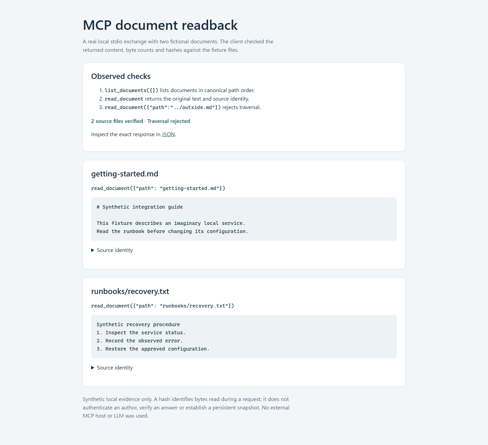

# Local documentation connector for MCP

Give an MCP client read-only access to one local documentation folder. A
`read_document` response includes the original UTF-8 text, a canonical relative path, byte count
and SHA-256, so an integration can check which source bytes it received.

[](https://github.com/skyon0522-ai/mcp-document-connector/actions/workflows/test.yml)



## Try the example

The example starts a real MCP server, lists two fictional documents, reads their
content, checks both against the fixture files and rejects `../outside.md`.
It saves an offline HTML report and the exact structured responses.

The verified environment is Ubuntu 24.04 under WSL2 with Python 3.12.3 and the
locked dependencies. Installation downloads packages; no API key or paid service
is needed. From the repository directory:

```sh
python3 -m venv .venv
.venv/bin/python -m pip install -r requirements.lock
.venv/bin/python demo.py --output-dir demo-output
```

Open `demo-output/report.html` in a browser. The output directory must be new;
existing paths are not replaced. Inspect the committed [HTML](examples/reports/report.html)
or [JSON](examples/reports/report.json) without installing the package.
GitHub shows HTML source; download the file to view the report.

| Observed check | Result |
| --- | --- |
| Tools exposed | `list_documents`, `read_document` |
| Source files checked | 2 |
| Original content, byte counts and hashes | Matched the fixtures |
| Traversal request | Rejected |

For `read_document({"path":"runbooks/recovery.txt"})`, the client receives:

```text
Synthetic recovery procedure
1. Inspect the service status.
2. Record the observed error.
3. Restore the approved configuration.
```

The full response contains `path`, `content`, `size_bytes` and `sha256`.
The source is [fixtures/docs/runbooks/recovery.txt](fixtures/docs/runbooks/recovery.txt).
The fictional documents contain no customer or workspace data.

## Read the implementation

| Start here | What it does |
| --- | --- |
| [connector.py](connector.py) | Document eligibility, canonical paths, reads and MCP tool handlers |
| [smoke.py](smoke.py) | Real stdio client, source-byte comparison and traversal check |
| [demo.py](demo.py) | The same exchange, plus escaped HTML and JSON exports |
| [Architecture](docs/architecture.md) | Request flow, source identity and trust boundaries |
| [test_connector.py](test_connector.py), [test_demo.py](test_demo.py) | Path/content contracts and reproducible report checks |

## Connect an MCP host

Configure your local MCP host to launch:

```sh
.venv/bin/python connector.py --root /absolute/path/to/approved-docs
```

The host launches that command as a subprocess. Server stdout is reserved for MCP
messages. No host configuration or credentials are changed by the repository.

| Tool | Input | Structured output |
| --- | --- | --- |
| `list_documents` | `{}` | Sorted entries with `path`, `size_bytes`, `sha256` |
| `read_document` | `{"path":"runbooks/recovery.txt"}` | The same metadata and original `content` |

## Verify

```sh
.venv/bin/python -m pytest -q --basetemp .test-temp
.venv/bin/python smoke.py --root fixtures/docs
```

The current local suite passed 24 tests. The tests cover UTF-8 and CRLF
preservation, hashes, ordering, noncanonical paths, symlink escapes, invalid UTF-8,
file-size and manifest-count boundaries. The report checks use real stdio reads,
compare committed outputs with the fixtures, check HTML escaping and refuse
replacement of existing output. The expected traversal rejection logs a tool error
to stderr. It is part of the successful negative check.

The workflow runs the suite, smoke check and report command. Its new report step
has not run on GitHub yet; consult the workflow page for remote results.
An external MCP host or LLM integration has not been tested.

## Boundaries

Supported extensions are `.md`, `.txt` and `.rst`, case-insensitively. Documents
must be valid UTF-8 and at most 262144 bytes. The manifest omits ineligible or
escaping files. More than 256 eligible documents produces an error rather than a
partial manifest. The connector exposes two read tools and no write operation.

Absolute paths, null bytes, backslashes, empty components, `.` and `..` are
rejected. Resolved paths must remain in the configured root; directory symlinks
are not traversed. Use an owner-controlled tree that stays stable during requests.
Point-in-time containment checks do not prevent hostile concurrent link swaps.

A hash identifies bytes read in one request. It does not authenticate an author,
verify an answer or establish a persistent snapshot. Direct Windows execution,
enterprise authorization, a search index and a RAG pipeline are outside the
verification here. No customer deployment or production outcome is claimed.

## License

Local code is [MIT-licensed](LICENSE). The dependency's required MIT notice is
retained in [LICENSES/mcp-python-sdk-MIT.txt](LICENSES/mcp-python-sdk-MIT.txt).
